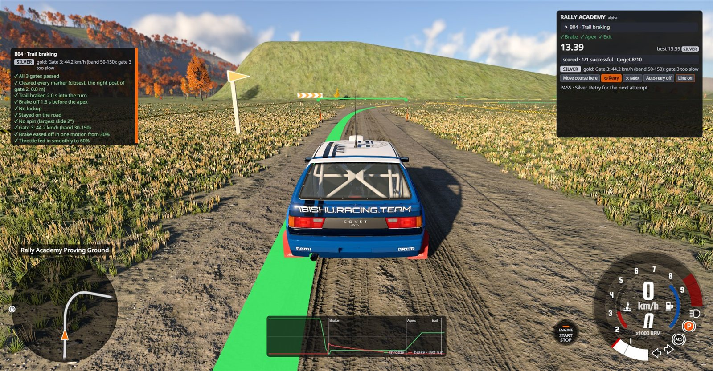
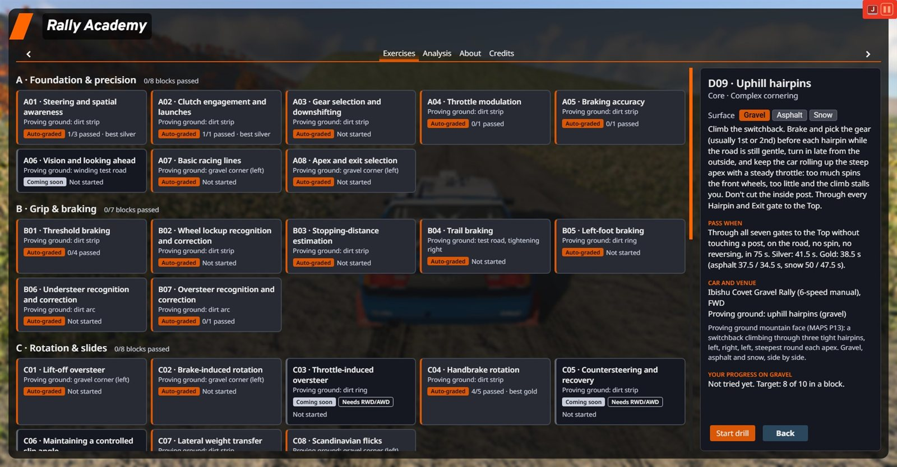
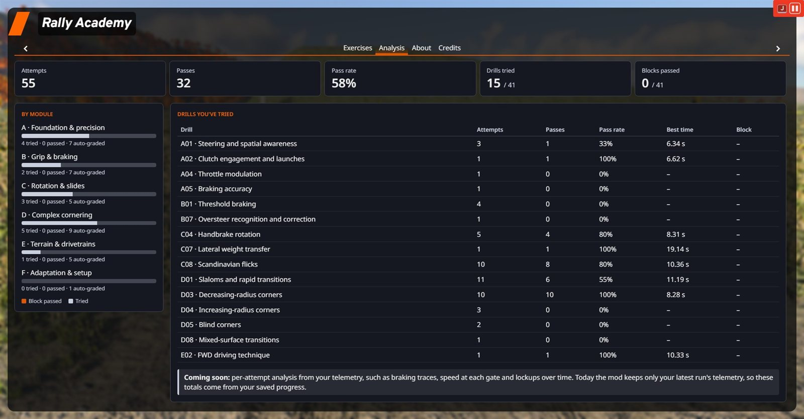
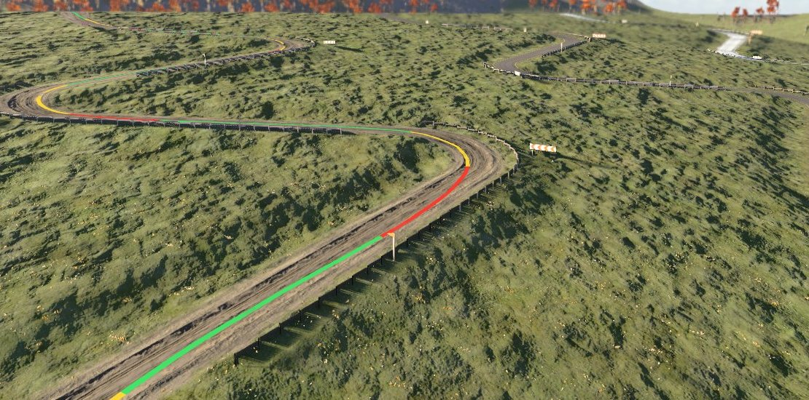
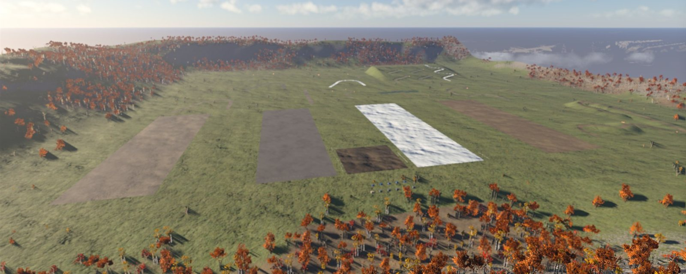

# Rally Academy for BeamNG.drive

[](https://github.com/p25marti/rally-academy/actions/workflows/ci.yml)

Structured rally-driving practice for BeamNG.drive: **41 drills** that build car control step by step, from
steering and braking accuracy to trail braking, rotation, hairpins, crests, jumps and water. Each drill sets itself
up on the mod's own map, grades your run from the car's telemetry and tells you what to change.



> **Status: alpha**, on BeamNG.drive 0.40. Everything below works and is tested in the game by scripted runs; the
> targets are still being tuned by real drivers.

## What it does

- **Drills that set themselves up.** Pick a drill and **Go to drill**: the mod loads its own map, the proving
  ground, puts you in the drill's car at the start and lays out the course with real cones and posts.
- **Automatic grading with medals.** 34 drills are graded from telemetry (speeds at gates, braking, lockups, slip,
  pedal smoothness, airtime, surface, damage) with bronze, silver and gold. Every check explains itself: "Brake
  pumped 3 times while easing off: one smooth release".
- **Instant retry.** One key puts you back at the start, car repaired; after a graded run the next attempt starts
  by itself unless you drive off.
- **Its own HUD.** A drill panel, a **Coach** (instructions before the run, the grade after it) and an **Inputs**
  graph of your throttle and brake, in a layout the mod brings along and you can rearrange.
- **Racing line and Watch AI.** **Show line** draws the drill's racing line on the road, red where to brake,
  yellow where to hold, green where to go. On the road drills, **Watch AI** lets the game's AI drive it first.
- **Surfaces.** 38 surface variants: the same drill on dirt, gravel, asphalt or snow, each with its own progress.
- **Progress and analysis.** Attempts, passes, best times and medals per drill, in an Academy screen in the main
  menu and the pause menu.
- **Hands on the wheel.** Every action has a default key on F13-F24, ready for a Stream Deck or button box
  ([profile included](extras/streamdeck/)).

## The drills

| Module | Drills | What it covers |
| --- | --- | --- |
| A · Foundation & precision | 8 | Steering and placement, launches, gear changes, throttle control, braking to a mark, racing lines |
| B · Grip & braking | 7 | Threshold braking, lockups, stopping distances, trail braking, left-foot braking, under- and oversteer |
| C · Rotation & slides | 8 | Lift-off and brake rotation, the handbrake, weight transfer, the Scandinavian flick |
| D · Complex cornering | 9 | Slaloms, linked and tightening corners, blind crests, hills, camber, surface changes, uphill hairpins |
| E · Terrain & drivetrains | 7 | FWD technique, crests, jumps, rough ground, water crossings |
| F · Adaptation & setup | 2 | Driving on with a puncture, comparing setups |

The full list, with where each drill runs, its surfaces and how it's graded: **[docs/DRILLS.md](docs/DRILLS.md)**.
Seven drills are self-assessed for now, five of them waiting for a rear- or all-wheel-drive car.

<table>
  <tr>
    <td></td>
    <td></td>
  </tr>
  <tr>
    <td align="center">The Academy screen: pick a drill</td>
    <td align="center">Analysis: your progress</td>
  </tr>
</table>



## The proving ground

Every drill runs on the mod's own generated map: flat strips of dirt, gravel, asphalt and snow, a corner built in
three surfaces, a winding test road, a hill circuit, banked and off-camber corners, a mountain switchback, a jump, a
rough track and a ford, with rally corner signs, barriers and autumn forests round it. It's built from a layout file
by [tools/mapgen](tools/mapgen/) ([MAPS](docs/MAPS.md)).



## Install

Rally Academy needs **BeamNG.drive 0.40**.

1. Download **`rally_academy.zip`** from the [latest release](https://github.com/p25marti/rally-academy/releases/latest)
   (a `.sha256` checksum sits next to it).
2. Put the zip, **still zipped**, in your BeamNG user folder's `mods` folder. On Windows that's
   `%LOCALAPPDATA%\BeamNG\BeamNG.drive\current\mods\`.
3. Start the game. In the main menu, open **More... → Rally Academy**, pick a drill and press **Start drill**: the
   proving ground loads with the drill's car at the start, and the HUD switches to the Rally Academy layout (you
   can turn that off on the Academy screen's About page).

**Keys:** every action has a default key on F13-F24 (none on a normal keyboard), so bind the ones you want in
Options → Controls (search "Rally Academy"), or use a Stream Deck with the [ready-made profile](extras/streamdeck/).
The list: [STREAM_DECK](docs/STREAM_DECK.md).

**Updating:** replace `rally_academy.zip` with the new one. The name never changes, so there's only ever one copy;
your progress is kept (it lives in `settings/rallyAcademy*` in the user folder). **Removing:** delete the zip, or
switch the mod off in the game's mod manager.

Developers running from a clone (`python tools/dev.py link`) should `python tools/dev.py unlink` before installing
the zip, so the game doesn't load two copies.

## Develop

```sh
python tools/dev.py check --strict   # validate data, lint, unit-test, build (what CI runs)
python tools/dev.py link             # live-link ./mod into your BeamNG mods folder
python tools/dev.py ingame smoke     # with the game running: scripted checks through its MCP server
```

Lua is unit-tested under LuaJIT with stubbed engine globals; scripted in-game scenarios drive the car to check the
grading against real physics. Start with [CONTRIBUTING.md](CONTRIBUTING.md); coding agents read
[AGENTS.md](AGENTS.md); product direction and the owner's standing decisions are in [PRODUCT](docs/PRODUCT.md).

## Repository map

| Path | What lives there |
| --- | --- |
| `mod/` | Exactly what ships: its contents become the zip root (`gameplay/`, `lua/`, `ui/`, `levels/`, `settings/`) |
| `mod/gameplay/rallyAcademy/exercises.json` | The 41 drills, the source of truth for drill data ([schema](docs/DRILL_DATA.md)) |
| `mod/levels/ra_proving_ground/` | The proving ground, generated by `tools/mapgen/` |
| `tests/` | Lua unit tests, Python tool tests and recorded in-game runs (fixtures) |
| `tools/dev.py` | One CLI: check, build, link, log, ship, in-game scenarios |
| `tools/ingame/` | Scripted in-game checks, venue surveys and recordings through the game's MCP server |
| `tools/mapgen/` | The proving ground's generator |
| `extras/streamdeck/` | A ready-made Stream Deck profile |
| `docs/` | How everything works; `docs/decisions/` holds the decision records |
| `reference/` | Source material: the original drill spreadsheet and planning history |

## Documentation

- [DRILLS](docs/DRILLS.md): every drill, where it runs and how it's graded
- [PRODUCT](docs/PRODUCT.md): what we're building and the standing decisions
- [ARCHITECTURE](docs/ARCHITECTURE.md): how the mod is put together
- [GRADING](docs/GRADING.md): the grading rules, targets and how they were set, drill by drill
- [DRILL_DATA](docs/DRILL_DATA.md): the drill schema and how to edit drills
- [MAPS](docs/MAPS.md) and [VENUES](docs/VENUES.md): the proving ground and how venues are found
- [DEVELOPMENT](docs/DEVELOPMENT.md) and [TESTING](docs/TESTING.md): setup, the dev loop, tests and in-game
  scenarios
- [BEAMNG_API_NOTES](docs/BEAMNG_API_NOTES.md): every engine API we rely on, and whether it's verified
- [ROADMAP](docs/ROADMAP.md), [IDEAS](docs/IDEAS.md) and the [CHANGELOG](CHANGELOG.md)
- [STREAM_DECK](docs/STREAM_DECK.md): default keys and a Stream Deck layout
- [RELEASING](docs/RELEASING.md): versions and releases
- [decisions/](docs/decisions/): short records of why things are the way they are

## Credits

Drill curriculum adapted from public rally-school syllabi (Richard Burns Rally, EA SPORTS WRC, DiRT Rally 2.0 / Jon
Armstrong, DirtFish, Team O'Neil). These are original exercises inspired by them, not reproductions of any school's
material and not official BeamNG missions. Stream Deck icons from the BEAM.deck pack ([credits](extras/streamdeck/)).
